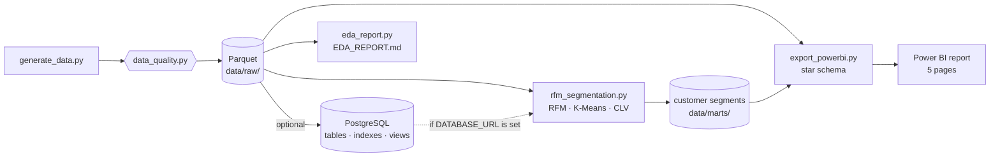
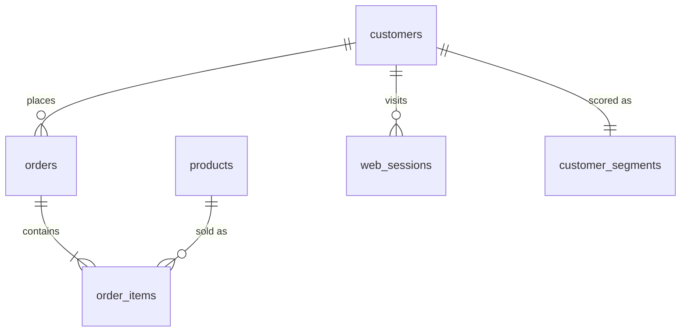

# Architecture

## Data flow

1. **Generate:** create customers, products, orders and web sessions, then check them (unique keys, valid
   foreign keys, totals that add up). If a check fails, nothing is written.
2. **Store:** save the tables as Parquet. If `DATABASE_URL` is set, also load them into PostgreSQL.
3. **Segment:** compute RFM, run K-Means, name the segments and estimate CLV.
4. **Report:** write the EDA report and export a star schema for Power BI.

The segmentation reads orders from PostgreSQL when `DATABASE_URL` is set (and writes the segments back), and
from Parquet otherwise. The results are the same either way. The Power BI export always reads Parquet.

## Main tables

Column details: [DATA_DICTIONARY.md](DATA_DICTIONARY.md).

## Key design decisions
1. **Customers have hidden types** (whale, loyal, one-time …), so the data has real patterns to find and a ground truth to check against.
2. **Parquet first, PostgreSQL optional**, so the project runs with only Python installed.
3. **Web sessions are sampled 1 in 10** with `sample_weight = 10` for non-buying sessions, to keep the table small; every session metric uses the weight.
4. **`log1p` before K-Means**, because spend and order counts are very skewed and would otherwise dominate.
5. **k ≥ 4**, because silhouette alone picks k = 3, which is too coarse for marketing.

## Security
- Emails are stored only as SHA-256 hashes, and all names are synthetic.
- The database URL comes from the environment (`.env`, git-ignored; see `.env.example`).
